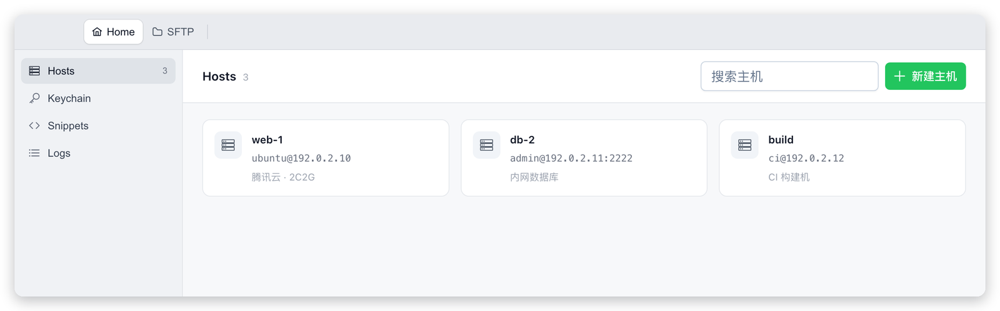

<div align="center">


<h1>SFTerm</h1>

<p>
  <strong>macOS 上的 SSH 与 SFTP 客户端</strong><br />
  终端按主机开标签；SFTP 一栏本地、一栏远端。
</p>

<p>
  
  <a href="https://github.com/wflixu/SFTerm/actions/workflows/ci.yml"></a>
  
  
  
  
  
</p>

<p>
  <a href="docs/requirements-v0.md">需求基线</a> ·
  <a href="docs/architecture.md">架构说明</a> ·
  <a href="docs/adr-002-stay-on-tauri.md">技术选型</a> ·
  <a href="https://github.com/wflixu/SFTerm/issues">问题反馈</a> ·
  <a href="LICENSE">许可</a>
</p>

</div>

<p align="center">
  
  <br />
  <sub>Home：主机卡片，双击开一个 SSH 终端标签（演示数据）</sub>
</p>

> [!NOTE]
> **0.1.0 · 开发中原型。** 只给作者本人使用，不对外分发；没有安装包、自动更新、i18n 和 onboarding。
> 主机、密钥、密码暂存在 WebView 的 localStorage 里 —— 暂时别拿它管你不在意的服务器。

## 什么是 SFTerm

- **终端和文件在一个窗口** —— 不装插件、不开第二个 App：SSH 终端是标签，SFTP 是常驻面板。
- **终端按主机开** —— 双击主机卡片开一个 SSH 标签，每个标签一条独立 SSH 会话，切走再切回不会断。
- **SFTP 是双栏的** —— 左本地、右远端，拖一下就传，不用先 `cd` 再 `get`。
- **只服务一个人** —— 中文界面、无引导、无账号、无遥测；怎么顺手怎么来。

## 界面

| 区域 | 内容 |
|---|---|
| 顶部 | 浏览器式标签：`Home`、`SFTP` 常驻；每连一台主机多一个终端标签，按 `IP:端口` 去重 |
| 主体 | `SFTP` 页双栏：左侧本地（只读）、右侧远端（可写），中间分隔条可拖动 |
| 底部 | 传输队列与连接状态；终端标签整页是 xterm |

- `SFTP` 页原地绑定一台主机，切主机不会另开标签。
- 同一个 `IP:端口` 只保留一个终端标签，重复双击只是切过去。

## 现在能做什么

| 能力 | 状态 |
|---|---|
| 主机管理：卡片、搜索、新建 / 编辑 / 删除 | 可用 |
| 双击主机 → 打开或切到该主机的 SSH 终端标签 | 可用 |
| 认证：密码、私钥（公钥认证） | 可用；带口令私钥引擎支持，表单还没有口令输入框 |
| SFTP 双栏：本地只读 + 远端可写，可拖动分隔条 | 可用 |
| 单文件上传 / 下载，底部进度队列 | 可用 |
| 同名冲突：覆盖 / 新建副本 / 跳过 | 可用（逐项确认） |
| 远端操作：新建文件夹、重命名、删除（目录递归） | 可用 |
| 终端：多标签、窗口自适应、切换标签不断线 | 可用 |
| 密钥条目：Label / 私钥 / 公钥、从文件导入 | 可用（存 localStorage） |
| Snippets / Logs | 空状态占位 |

## 还不能做什么

- **目录传输**：只传单个文件，选中文件夹会提示「文件夹传输暂不支持」。
- **拖拽**：上传下载只能走右键菜单，不能从 Finder 拖进窗口。
- **暂停 / 取消 / 重试 / 断点续传**：开始传就一直传到结束。
- **冲突预检与「对全部应用」**：逐个弹窗，没有批量策略。
- **远端 chmod、多选、排序、隐藏文件开关、快速过滤**。
- **主机指纹确认（TOFU）**：只显示指纹，不比对、不阻断。
- **系统 Keychain / SQLite**：主机、密钥、密码都在 localStorage。
- **断线自动重连**：终端有「重连」按钮，SFTP 断了要手动重连。
- **设置页、Snippets、日志、预览、`sftp://`、跳板机**。

完整的规格与逐条状态见 [需求基线](docs/requirements-v0.md) 的 §7。

## 技术栈

| 层 | 选型 |
|---|---|
| 壳 / 打包 | Tauri 2（macOS 是唯一目标） |
| 界面 | Vue 3 + TypeScript + Vite 6 + PrimeVue 4（Aura）+ Pinia 3 |
| 终端 | xterm.js 5 + addon-fit，每个标签一条独立 SSH 会话 |
| SSH / SFTP | Rust `ssh2` 0.9（libssh2），阻塞 API 跑在专用线程 |
| 存储 | 过渡期 localStorage，计划换 SQLite + 系统 Keychain |

为什么留在 Tauri、放弃 Swift 原生方案，见 [ADR-002](docs/adr-002-stay-on-tauri.md)（[ADR-001](docs/adr-001-swift-native-macos.md) 是存档）。

线程模型、命令与事件、状态管理在 [architecture.md](docs/architecture.md)。

## 开发

前置：macOS + Xcode Command Line Tools、Rust（版本由 [rust-toolchain.toml](rust-toolchain.toml) 锁定为 1.98.1）、Node 22 + pnpm 10。

```bash
pnpm install
pnpm tauri dev        # 开发模式（Vite 固定 5173，端口被占会直接报错）
pnpm build            # vue-tsc 类型检查 + 前端构建
pnpm test:unit        # Vitest
pnpm lint             # oxlint + eslint
```

Rust 侧（根 `Cargo.toml` 是 workspace，成员为 `sfterm-core` 引擎与 `app` 壳；`tools/probe` 不在其中）：

```bash
cargo test  -p sfterm-core
cargo check -p app
# 不开 UI 也能验连通性 / 传输：
cargo run -p sfterm-core --bin engine-check -- \
  --host <host> --user <user> --key ~/.ssh/id_ed25519 --path /home
```

### 常见问题

| 现象 | 处理 |
|---|---|
| `pnpm tauri dev` 起不来，提示端口占用 | Vite 设了 `strictPort`。先 `lsof -nP -iTCP:5173 -sTCP:LISTEN`，杀掉旧进程再启动 |
| 首次启动卡很久 | 第一次要编译整套 Rust 依赖，几分钟属正常；之后是增量编译 |
| 想清空主机 / 密钥 | 目前没有重置入口，只能在 Home 里逐个删除；数据存在 WebView 的 localStorage（bundle id `cn.wflixu.sfterm`） |
| 界面白屏或操作没反应 | 看 `pnpm tauri dev` 的终端输出：Rust 侧错误与 `tauri-plugin-log` 都打在 stdout / stderr |
| 改了 Vue 页面不生效 | 确认 dev server 还活着、端口仍是 5173；改 Rust 或 `src-tauri` 配置需要重启 |

### 发布

打 tag 触发 GitHub Actions，自动构建、签名、公证并发布 macOS arm64 的 `.dmg` 和 `.app.zip`：

```bash
git push                    # 先把当前分支推上去
git tag v0.2.0
git push origin --tags      # tag 必须是 v + 版本号
```

版本号必须同时改 `package.json` 与 `src-tauri/tauri.conf.json`，tag 必须等于 `v<version>`。签名与公证需要的 Secrets 见 [docs/ci.md](docs/ci.md)。

## 目录结构

```
Cargo.toml              workspace 根，成员：crates/core、src-tauri
.github/workflows/      CI（PR 测试）与 Release（tag 发版）
src/                    Vue 应用
  components/           DualPane（双栏）、FilePane（单栏）、HostPicker
  views/home/           Home：Hosts / Keychain / Snippets / Logs
  views/sftp/           SFTP 常驻页
  views/terminal/       终端标签页
  stores/               system · keychain · sftp · tabs · terminals · transfers
  router/               /（Home）、/sftp、/terminal/:hostId
crates/core/            Rust 引擎：连接、SFTP、本地 fs、shell（crate sfterm-core）
  src/bin/check.rs      engine-check CLI
src-tauri/              Tauri 壳：commands（cmds.rs）、事件、窗口配置（crate app）
tools/probe/            sft-probe：早期的连通性 / 算法探测工具
docs/                   需求基线、架构说明、ADR
```

## 路线图

不做承诺，只记方向；细节与待定项见 [roadmap](docs/roadmap.md)。

| 阶段 | 内容 |
|---|---|
| 0.1.x | 目录递归传输、拖拽、传输取消 / 暂停、主机指纹确认 |
| **0.2.0** | **密码存储**：凭据进系统 Keychain，主机与设置进 SQLite，迁掉明文 localStorage<br>**终端命令历史**：命令与输出跨重启保留、可搜索 |
| 0.3+ | 设置页（下载目录 / 并发 / 字号）、断线自动重连、Snippets 落地、文件预览、`sftp://` |

## 文档

| 文档 | 内容 |
|---|---|
| [需求基线 v0.6](docs/requirements-v0.md) | 已确认决策、界面规格、功能清单与逐条状态 |
| [架构说明](docs/architecture.md) | 线程模型、命令与事件、标签与会话、技术债 |
| [路线图](docs/roadmap.md) | 版本节奏、0.2.0 两个问题的现状 / 待定 / 验收 |
| [CI / 发布](docs/ci.md) | PR 测试、tag 发版、签名公证需要的 Secrets |
| [ADR-002](docs/adr-002-stay-on-tauri.md) | 为什么留在 Tauri 技术栈 |
| [ADR-001](docs/adr-001-swift-native-macos.md) | Swift 原生方案（已被取代，存档） |

## 许可

[GNU General Public License v3.0 only](https://www.gnu.org/licenses/gpl-3.0.html)（`GPL-3.0-only`），Copyright (C) 2025 Lixu，全文见 [LICENSE](LICENSE)。

分发修改版时需同样以 GPL-3.0 开源并保留版权声明；本程序不提供任何担保。
